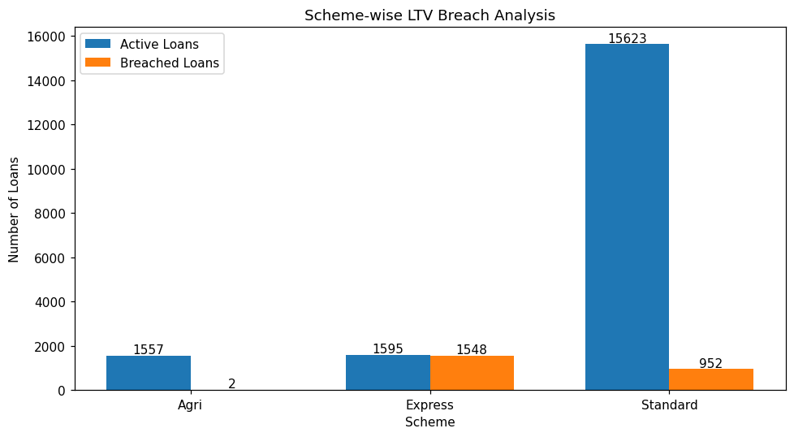
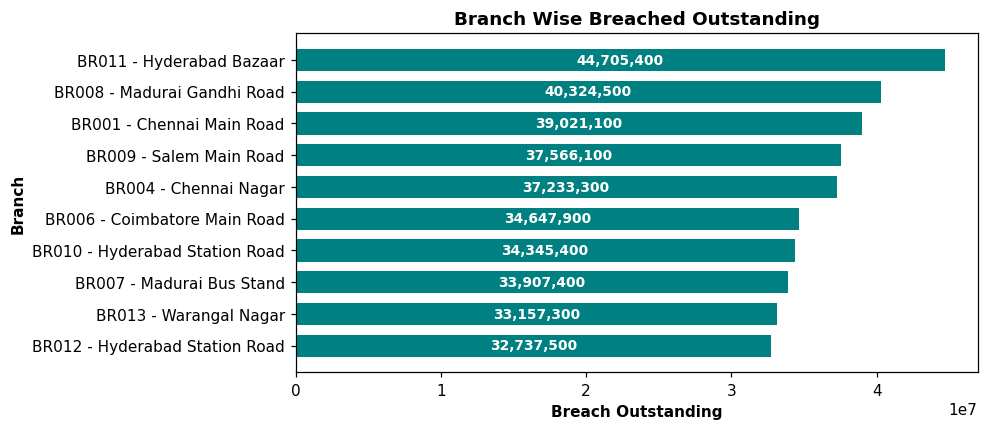
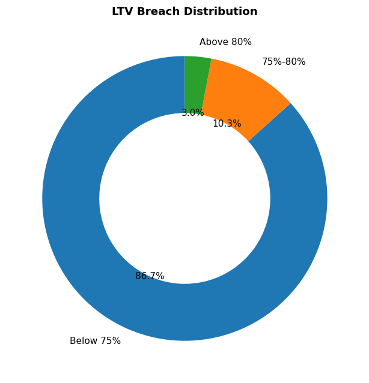
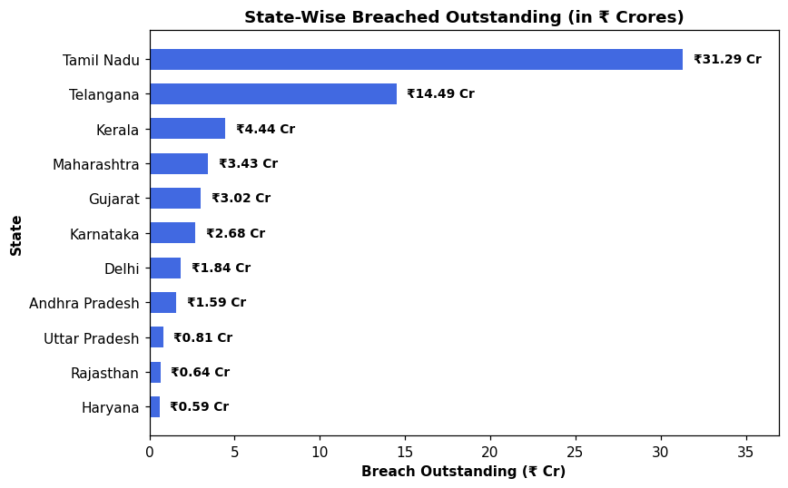

# Gold Loan LTV Breach Early Warning

**Banking & Finance** · SQL, Python (pandas, seaborn)

Gold prices have fallen sharply. Find which active gold loans now breach the regulatory LTV cap, how much money is at risk, and where.

> A live industry project on [JobPrax](https://www.jobprax.com). The client, Suvarna Finance Ltd, and its data are simulated.
> Certificate: [https://www.jobprax.com/certificates/DD-2V7F-8FVX](https://www.jobprax.com/certificates/DD-2V7F-8FVX)

## Business problem

Management does not know how many active gold loans currently breach the 75% LTV cap, how much outstanding principal is exposed, or which schemes, states and branches are driving the problem. The risk team needs a reliable, reproducible assessment as of 15 October 2026 to plan margin calls before the next risk committee.

## Objectives

- Measure the fall in the gold rate from its 2026 peak to the assessment date.
- Recalculate the current LTV of every active gold loan using the latest gold rate.
- Quantify the number of loans and the outstanding principal above the 75% cap, and above 80% (critical).
- Identify the schemes, disbursal periods, states and branches that contribute most to breaches.
- Recommend a prioritised margin-call plan and any change needed to lending policy.

## Executive summary

This analysis evaluates Suvarna Finance Ltd.'s gold loan portfolio as of 15 October 2026 to identify loans exceeding the 75% Loan-to-Value (LTV) limit following the decline in gold prices.

The 24K gold rate declined from its 2026 peak of ₹11,450 per gram on 12 September 2026 to ₹10,280 per gram on 15 October 2026, representing a 10.22% fall.

After data cleaning, 18,859 active loans were identified. Of these, 84 were excluded from the LTV assessment due to missing gold weight or non-positive principal. The final analysis covered 18,775 assessable active loans.

The analysis identified the following key findings:

Overall exposure: 2,502 loans (13.33%) exceeded the 75% LTV limit, with approximately ₹64.81 crore in outstanding principal exposed.

Critical cases: 564 loans exceeded 80% LTV and require priority attention.

Scheme risk: Express was the highest-risk scheme, with 1,548 of its 1,595 assessable active loans (97.05%) exceeding the 75% limit.

Disbursal period: September 2026 recorded the highest number of breached loans, with approximately 814 cases.

Geographical exposure: Tamil Nadu recorded the highest breached outstanding at approximately ₹31.29 crore.

Branch exposure: Hyderabad Bazaar had the highest breached outstanding among the branches, at approximately ₹4.47 crore.

Customer segment: Small Business Owners recorded the highest number of breaches, with 673 cases.

Stress scenario: A further 5% decline in gold prices could increase the number of loans exceeding the 75% threshold to 4,580.

Based on these findings, the report recommends prioritised margin calls, immediate attention to loans above 80% LTV, a review of Express scheme lending practices, and continuous monitoring through an LTV early-warning system.

These actions will help Suvarna Finance manage its collateral risk, prioritise collection efforts and reduce the possibility of further LTV breaches.

## Key findings

A. Gold price movement
The highest 24K gold rate recorded in 2026 was ₹11,450 per gram on 12 September 2026. By the assessment date, 15 October 2026, the rate had declined to ₹10,280 per gram.

This represents a 10.22% fall from the 2026 peak, reducing the value of gold pledged as collateral and increasing the LTV of existing loans.

B. Overall portfolio risk
After removing duplicate records and applying the assessment rules, 18,859 active loans were identified. Of these, 84 loans could not be assessed because they had missing gold weight or a principal amount of zero or less.

Therefore, the final assessment covered 18,775 assessable active loans.
- 2,502 loans (13.33%) exceeded the 75% LTV limit.
- The outstanding principal associated with these breached loans was approximately ₹64.81 crore.
- 1,938 loans were in the 75–80% LTV range.
- 564 loans had an LTV above 80%, representing the critical-risk category.
This indicates that the risk is not limited to a small number of customers. A significant amount of the active portfolio requires monitoring and corrective action.

C. Scheme-wise risk
The Express scheme is the most significant contributor to LTV breaches.
Scheme	Assessable active loans	Breached loans	Breach rate
Agri	1,557	2	0.13%
Express	1,595	1,548	97.05%
Standard	15,623	952	6.09%

Finding: Almost all assessable active Express loans have crossed the 75% LTV limit. With 1,548 breached loans out of 1,595, Express represents the highest-risk lending scheme and requires immediate policy review.

D. Disbursal-month analysis
The highest number of breached loans was associated with loans disbursed in September 2026, with approximately 814 breaches.
Disbursal month	Breached loans
June 2026	294
July 2026	526
August 2026	761
September 2026	814
October 2026	107

Finding: Breaches increased across the June–September disbursal cohorts, with September recording the highest count. This makes the September lending cohort an important priority for further review.

Note: October figures cover disbursals only up to 15 October 2026. These numbers represent the disbursal month of loans that are currently in breach, not the month in which the breach first occurred.

E. State-wise risk
Tamil Nadu recorded the highest breached-loan outstanding, amounting to approximately ₹31.29 crore.

Finding: Tamil Nadu accounts for the largest state-level financial exposure among the breached loans. It should be prioritised for collection planning, branch-level monitoring and customer follow-up.

F. Branch-wise risk
Hyderabad Bazaar recorded the highest breached-loan outstanding among the 36 branches, at approximately ₹4.47 crore.

Finding: Hyderabad Bazaar represents the largest branch-level financial exposure. The Collections team should prioritise this branch when preparing customer-level margin-call lists.

G. Customer occupation analysis
Small Business Owners recorded the highest number of LTV-breached loans, with 673 cases.

Finding: Small Business Owners form the largest occupation group among breached loans. The Collections team should include this customer segment in its priority monitoring list, while considering each customer's outstanding amount and LTV severity.

H. Stress-test analysis
A further 5% decline in the gold rate from the assessment-date level of ₹10,280 per gram was simulated.

Under this scenario, 4,580 assessable active loans would exceed the 75% LTV threshold.

Finding: A further decline in gold prices could significantly increase the number of loans requiring corrective action. Suvarna Finance should monitor gold prices and LTV levels regularly instead of waiting for loans to cross the regulatory threshold.

## Recommendations

1. Prioritise Margin Calls
- Contact customers with LTV above 80% first, followed by those in the 75–80% range.
- Ask customers to repay part of the loan or pledge additional gold.

2. Review Express Scheme
- Reassess the Express scheme's high-LTV lending practices.
- Consider a proposed internal LTV limit of 65–70% to maintain a safety buffer.

3. Focus on High-Risk Locations
- Prioritise Tamil Nadu due to its ₹31.29 crore exposure.
- Begin collection planning with Hyderabad Bazaar, which has ₹4.47 crore in breached outstanding.

4. Strengthen LTV Monitoring
- Monitor gold prices and recalculate LTV regularly.
- Set early-warning alerts for loans approaching the 75% threshold.

## Charts









## What I did

- Solved 50 of 50 analysis tasks tied to the business requirements
- Wrote 3 SQL queries, one per task, in [`sql/`](sql)
- Explored and charted the data in Python, in [`notebook/analysis.ipynb`](notebook/analysis.ipynb)
- Wrote a final report with findings and recommendations, in [`report/report.md`](report/report.md)

## Skills

Data cleaning · Joins and aggregation · Business rules · Risk metrics · Executive reporting

## Data

- **Gold loans** (`gold_loans.csv`): One row per loan as extracted from the loan system. Contains duplicates and inconsistent formats.
- **Repayments** (`repayments.csv`): Every payment received. Interest payments do not reduce the principal.
- **Gold rates** (`gold_rates.csv`): Daily 24K gold rate used for valuation (no rates on Sundays and some holidays).
- **Branches** (`branches.csv`): Branch master data.
- **Customers** (`customers.csv`): Customer profile (no personal identifiers).

Column details and a sample of each table are in [`data/`](data).

## Repository structure

```
sql/          one SQL file per task
notebook/     Python analysis
report/       final report and charts
data/         table samples and column descriptions
```
